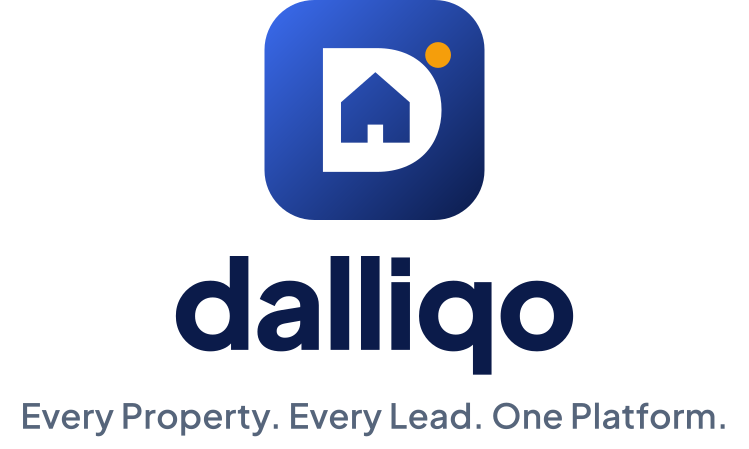

# Dalliqo — Brand Guidelines



| | |
|---|---|
| **Product name** | Dalliqo (always one word with a capital D in running text; the logo wordmark is lowercase `dalliqo`) |
| **Tagline** | Every Property. Every Lead. One Platform. |
| **Descriptor** | Real Estate CRM & Business Management Platform |
| **Urdu tagline** | ہر پراپرٹی۔ ہر لیڈ۔ ایک پلیٹ فارم۔ (the name *Dalliqo* is never translated or transliterated) |

---

## 1. Single source of truth

Every colour, radius, font setting and logo file comes from **one file**:

```
shared/brand/dalliqo.tokens.json
```

The generator `tools/brand/build.mjs` reads it and writes all derived assets. **Never hand-edit a generated file**; change the tokens and regenerate:

```bash
npm --prefix tools/brand install
npm --prefix tools/brand run build
```

| Output | Path | Used by |
|---|---|---|
| CSS variables (light + dark) | `web/src/styles/brand.css` | React web (via Tailwind `brand-*`, `canvas`, `surface`, `ink`, `muted`, `on-brand`, `accent`) |
| TypeScript constants | `shared/src/brand.ts` (`BRAND`) | Web charts, server PDF/Excel exports |
| Dart constants | `mobile/lib/core/theme/brand_tokens.dart` (`Brand`, `BrandLight`, `BrandDark`) | Flutter `AppTheme` |
| Master logos (SVG) | `branding/svg/` | Everything else |
| Raster logos (PNG, transparent) | `branding/png/` | Documents, presentations, e-mail |
| Favicons + PWA icons + manifest | `branding/favicon/`, copied to `web/public/` | Browser tab, home-screen installs |
| Web logo components | `web/src/assets/brand/*.svg`, `web/src/components/BrandLogo.tsx` | Login, sidebar |
| Mobile logos + font | `mobile/assets/brand/`, `mobile/assets/fonts/` | Splash, sign-in |
| Android launcher/splash | `mobile/android/app/src/main/res/` (mipmap-*, drawable-*, values-v31) | Launcher icon, adaptive & themed icon, Android 12+ splash |
| iOS AppIcon/LaunchImage | `mobile/ios/Runner/Assets.xcassets/` | Home screen, launch screen |
| Report logo | `server/assets/brand/` | PDF exports |
| Contrast audit | `branding/contrast-report.json` | QA (generator fails loudly if a pair drops below WCAG AA) |

---

## 2. The logo

### Concept
The mark is a bold **D** whose counter is a **house with a door** — the product's initial and its industry in one shape. The **amber dot** at the top-right is the "lead": the opportunity the platform helps you catch. It sits on a rounded tile with a deep blue gradient (`#3B6CF0 → #0B1B4A`), which reads as trustworthy and modern at every size from a 16 px favicon to a billboard.

The wordmark `dalliqo` is set in **Plus Jakarta Sans ExtraBold (800)**, lowercase and converted to outlines, so the logo looks identical everywhere without needing the font installed.

### Variants

| Variant | Light backgrounds | Dark backgrounds | When to use |
|---|---|---|---|
| **Primary (stacked)** — mark, wordmark, tagline | `dalliqo-logo-primary.svg` | `dalliqo-logo-primary-dark.svg` | Covers, splash screens, title slides |
| **Horizontal** — mark + wordmark | `dalliqo-logo-horizontal.svg` | `dalliqo-logo-horizontal-dark.svg` | App headers, login, reports, e-mail signatures, README |
| **Mark (app icon)** | `dalliqo-mark.svg` (rounded tile) · `dalliqo-mark-square.svg` (full-bleed for store icons) | same | Favicon, app icon, avatar, small spaces |
| **Mark, one colour** | `dalliqo-mark-mono.svg` (midnight) | `dalliqo-mark-white.svg` | Embossing, fax/print in one colour, Android themed icon |
| **Wordmark only** | `dalliqo-wordmark.svg` | `dalliqo-wordmark-white.svg` | When the mark already appears nearby |

PNG exports of each logo exist at 600, 1200 and 2400 px wide, and of the mark at 16–1024 px (all with transparent backgrounds, except the flattened iOS / Apple touch icons, which Apple requires).

### Clear space and minimum size
* **Clear space:** keep empty space around the logo equal to the height of the amber dot × 2 (≈ ¼ of the mark's height) on every side.
* **Minimum size:** horizontal logo 96 px / 24 mm wide on screen and print; mark 16 px (favicon, already pixel-checked); primary stacked logo 140 px wide.

### Don't
* Don't recolour, stretch, rotate, outline or add shadows to the logo.
* Don't place the light logo on a dark or busy background — use the `-dark` version (white wordmark) instead.
* Don't remove the amber dot or move it to another position.
* Don't retype the wordmark in another font or with a capital D in the logo.
* Don't put the mark inside another shape (circle, badge); the rounded tile is the shape.

---

## 3. Colour

### Brand palette

| Token | Hex | Role |
|---|---|---|
| primary-50 | `#EEF3FF` | Soft selected backgrounds, table zebra rows |
| primary-100 | `#DCE6FE` | Hover tints, table headers |
| primary-200 | `#BFD1FD` | Decorative |
| primary-300 | `#93B2FB` | Decorative, charts |
| primary-400 | `#6E93F6` | Focus ring (dark mode) |
| **primary-500** | **`#3B6CF0`** | Logo gradient start, focus ring, first chart colour |
| **primary-600** | **`#1D4ED8`** | **Primary actions (light mode), links, header rules** |
| primary-700 | `#1A3FB0` | Hover/pressed state |
| primary-800 | `#16338A` | Decorative |
| **primary-900 / Midnight** | **`#0B1B4A`** | Logo gradient end, wordmark, splash, theme-color, headings in documents |
| **accent-500 / Amber** | **`#F59E0B`** | The "lead" dot, highlights, second chart colour — used sparingly |
| accent-300 / 600 | `#FCD34D` / `#D97706` | Accent tints |
| success | `#15803D` | Won, completed, paid |
| warning | `#B45309` | Due soon, attention |
| danger | `#DC2626` | Overdue, delete, errors |
| info | `#0369A1` | Informational |

### Semantic UI tokens

| Token | Light | Dark |
|---|---|---|
| canvas (page background) | `#F5F7FB` | `#0A1020` |
| surface (cards, inputs) | `#FFFFFF` | `#121A2E` |
| line (borders) | `#E2E8F0` | `#26324B` |
| ink (body text) | `#0F172A` | `#E6EBF5` |
| muted (secondary text) | `#56657B` | `#9AA8BF` |
| primary (buttons, links) | `#1D4ED8` | `#7FA3FF` |
| primary hover | `#1A3FB0` | `#A5BFFF` |
| on-primary (button label) | `#FFFFFF` | `#0B1B4A` |
| primary soft (selected nav) | `#EEF3FF` | `#17244A` |
| primary soft ink | `#1A3FB0` | `#A5BFFF` |

In dark mode the primary becomes a **lighter** blue with a **midnight** label rather than a white label on dark blue — this keeps buttons readable on the dark surfaces (6.76 : 1) and is applied identically on web and mobile.

### Accessibility (WCAG 2.1 AA — measured by the generator)

| Pair | Light | Dark |
|---|---|---|
| Body text on surface | 17.85 | 14.48 |
| Body text on canvas | 16.65 | 15.86 |
| Secondary text on surface | 5.93 | 7.20 |
| Secondary text on canvas | 5.53 | 7.88 |
| Links on surface | 6.70 | 7.08 |
| Button label on primary | 6.70 | 6.76 |
| Button label on primary (hover) | 8.82 | 9.05 |
| Selected nav text on soft primary | 7.93 | 8.28 |
| Midnight text on amber | 7.70 | 7.70 |

All 20 checked text pairs pass AA (≥ 4.5 : 1); the lowest is 5.53.

---

## 4. Typography

| Use | Typeface | Weight |
|---|---|---|
| Logo wordmark | Plus Jakarta Sans (outlined in the logo) | 800 |
| Headings | Plus Jakarta Sans | 700 (page titles 700–800, letter-spacing −0.01em) |
| Body, tables, forms | Plus Jakarta Sans | 400 / 500 |
| Buttons, labels, tagline | Plus Jakarta Sans | 600 |
| Urdu | Noto Nastaliq Urdu (fallback Noto Naskh Arabic) | 400 / 600 |

* **Web:** self-hosted through `@fontsource/plus-jakarta-sans` and `@fontsource/noto-nastaliq-urdu` (no third-party font CDN at runtime; works offline/behind firewalls).
* **Mobile:** bundled TTFs in `mobile/assets/fonts/` (registered in `pubspec.yaml`), licence `OFL-PlusJakartaSans.txt`.
* **PDF manuals:** embedded from the same TTFs.
* Plus Jakarta Sans and Noto are licensed under the SIL Open Font License 1.1 (free for commercial use and embedding).

---

## 5. Components

| Element | Rule |
|---|---|
| Primary button | `primary` background, `on-primary` label, radius 10 px (`md`), weight 600, min height 48 px on mobile |
| Secondary button | Surface background, `line` border, ink label |
| Cards | Surface, 1 px `line` border, radius 14 px (`lg`), no heavy shadow |
| Inputs | Surface, `line` border, radius 10 px; focus = 2 px `primary-500` (light) / `primary-400` (dark) ring |
| Navigation | Selected item = `primary soft` background + `primary soft ink` text; app header shows the mark + business name |
| Icons | Lucide (web) / Material Symbols outlined (mobile), 1.5–2 px stroke, colour inherits text |
| Charts | Order: primary-500, amber, success, violet, danger, cyan, slate (from `BRAND.color`) |
| Radii | sm 8 · md 10 · lg 14 · xl 20 (logo tile ≈ 23 % of its size) |
| Status colours | Only for meaning (success / warning / danger / info) — never as decoration |

---

## 6. Applications

| Touchpoint | Implementation |
|---|---|
| Browser tab | Title "Dalliqo — Real Estate CRM", SVG + ICO + PNG favicons, theme-color `#0B1B4A`, web manifest |
| Web login / register / reset | Horizontal logo (auto light/dark) + tagline |
| Web sidebar | Mark + business name |
| Mobile app name | "Dalliqo" (Android `android:label`, iOS `CFBundleDisplayName`) |
| Mobile icon | Adaptive icon (gradient background + white D/house foreground + amber dot), Android 13 themed (monochrome) icon, iOS AppIcon set |
| Mobile splash | Midnight `#0B1B4A` background with the primary-dark logo — native (Android launch theme & Android 12 splash API, iOS LaunchScreen) and in-app `BrandSplash` |
| Notifications | Android channel name "Dalliqo notifications" |
| E-mail | Sender "Dalliqo <…>", password-reset subject "Reset your Dalliqo password", signature line with tagline |
| PDF / Excel reports | Logo top-right, primary-600 header row, primary-50 zebra rows, footer "Generated with Dalliqo · tagline · Page X of Y" |
| User manuals | Midnight-gradient cover with the logo + tagline and amber accent; header with mark + "Dalliqo"; footer with tagline, version and page numbers; brand colours for headings, rules, tables and notes; Plus Jakarta Sans embedded |

### Applying the brand to future manuals and documents
New manuals built with `tools/manuals` automatically inherit the branding (logo, palette, typeface, header/footer) from `tools/manuals/build.mjs` and `PRODUCT` / `TAGLINE` in `tools/manuals/content.mjs`. For other documents use the horizontal logo top-left or top-right, Midnight headings, primary-600 rules and the footer pattern *Dalliqo · Every Property. Every Lead. One Platform. · Page X of Y*.

---

## 7. Technical identifiers that intentionally did not change

To avoid breaking installs, stored sessions, data and integrations, internal identifiers keep their original names: npm packages `@recrm/*`, Dart package `real_estate_crm`, Android `applicationId` `com.recrm.real_estate_crm`, iOS `CFBundleName`, the refresh-token cookie `recrm_rt`, local storage keys, database names and demo e-mail domains. They are never shown to end users. Changing the store bundle IDs is a separate release decision (it creates a new app listing).
