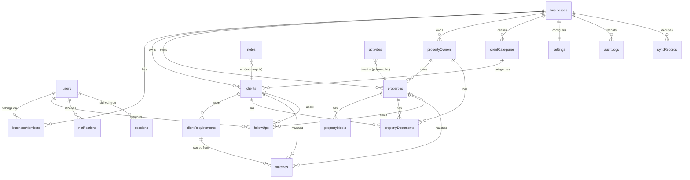

# Database design (MongoDB + Mongoose)

MongoDB runs as a **replica set** in every environment (single node locally) because the API uses
multi-document transactions (registration, member creation, property creation + ID counter).

## Conventions

**Tenant base** — every business-owned document has:

| Field | Type | Notes |
|---|---|---|
| `businessId` | ObjectId → businesses | required, immutable, first field of every compound index |
| `createdBy` / `updatedBy` | ObjectId → users | set by the service layer from the AuthContext |
| `createdAt` / `updatedAt` | Date | Mongoose `timestamps` |

**Sync base** — entities the mobile app edits offline (clients, clientRequirements, propertyOwners,
properties, followUps, notes) additionally have:

| Field | Type | Notes |
|---|---|---|
| `uuid` | string (UUID v4) | generated **on the device** at creation; unique per business; makes offline creates idempotent |
| `version` | int | incremented on every write; used for optimistic concurrency and conflict detection |
| `deletedAt` | Date \| null | soft delete / tombstone so deletions sync to other devices |

Other rules: money is stored as **integer PKR** (no floats); sizes store the entered value + unit and a
normalised `sizeSqft` for matching/filters; phone numbers are stored in E.164 (`+923001234567`);
free-text search uses a `text` index or normalised lowercase fields.

## Entity relationship diagram

## Collections

### users ✅ (global identity, not tenant-scoped)
`email` (unique, lowercase) · `passwordHash` (argon2id, `select:false`) · `fullName` · `mobileNumber` ·
`status` ACTIVE|DISABLED · `defaultBusinessId` · `mustChangePassword` · `passwordChangedAt` ·
`failedLoginAttempts`/`lockUntil` (`select:false`) · `lastLoginAt` · `preferences{language,theme}`.
Indexes: `{email:1}` unique.

### businesses ✅ (the tenant; `_id` = businessId)
`name` · `ownerUserId` · `phone` · `email` · `address` · `city` · `country` (PK) · `currency` (PKR) ·
`timezone` (Asia/Karachi) · `defaultSizeUnit` · `status`. Indexes: `{ownerUserId:1}`.

### businessMembers ✅
`businessId` · `userId` · `role` (OWNER, MEMBER; future ADMIN…VIEWER) · `permissions[]` · `status`
ACTIVE|SUSPENDED|REMOVED · `joinedAt`. Indexes: `{businessId,userId}` unique, `{businessId,status}`,
`{userId,status}`. Tenant guard on.

### sessions ✅ (refresh-token sessions, one per signed-in device)
`userId` · `businessId` · `memberId` · `tokenHash` (HMAC-SHA256, unique) · `prevTokenHash` (reuse
detection) · `clientType` web|mobile · `deviceName` · `userAgent` · `ip` · `expiresAt` (TTL index) ·
`lastUsedAt` · `revokedAt` · `revokedReason`.

### passwordResetTokens ✅
`userId` · `tokenHash` (unique) · `expiresAt` (TTL) · `usedAt` · `requestedIp`.

### auditLogs ✅ (append-only)
`businessId` · `actorUserId` · `action` (e.g. `property.updated`) · `entityType` · `entityId` ·
`entityLabel` (e.g. `RE-000125`) · `changes[{field,oldValue,newValue}]` · `meta` · `ip` · `createdAt`.
Indexes: `{businessId,createdAt:-1}`, `{businessId,entityType,entityId,createdAt:-1}`,
`{businessId,actorUserId,createdAt:-1}`.

### counters ✅
`_id: "<businessId>:property"` · `seq`. Atomic `$inc` inside the property-creation transaction →
`RE-000001` per business.

### clientCategories ✅
`key` (built-ins: PLOT_BUYER…INVESTOR) · `name` · `nameUr` · `isSystem` · `sortOrder` · `archivedAt`.
Seeded per business at registration. Index `{businessId,key}` unique (sparse for custom), `{businessId,name}` unique.

### clients ✅ (sync base)
`fullName` · `mobileNumber` · `alternateNumber` · `whatsappNumber` · `email` · `address` · `categoryId` ·
`status` ACTIVE|ON_HOLD|CLOSED_WON|CLOSED_LOST|INACTIVE · `priority` · `source` · `assignedTo` (userId) ·
`notes` (short summary; long-form notes live in `notes`) · `searchText` (normalised name+phones).
Requirement summary fields from the spec (`preferredArea`, `preferredSociety`, `preferredBlock`,
`propertyTypeRequired`, `minSize`/`maxSize`/`sizeUnit`, `minBudget`/`maxBudget`, `purchaseOrRental`)
are stored on the client's **primary requirement** (below) and denormalised onto the client for list
filtering.
Indexes: `{businessId,uuid}` unique · `{businessId,mobileNumber}` · `{businessId,status,updatedAt:-1}` ·
`{businessId,categoryId}` · `{businessId,assignedTo}` · `{businessId,updatedAt:1,_id:1}` (sync pull) ·
text index on `fullName, searchText, preferredArea, preferredSociety`.

### clientRequirements ✅ (embedded in clients)
A client can want more than one thing (e.g. a plot to buy *and* a flat to rent). Requirements are
**embedded subdocuments of the client** so a client and its wishes are created, edited and synced
offline as one unit; matches reference `requirementId` (the subdocument id).
`clientId` · `isPrimary` · `propertyTypes[]` · `purpose` PURCHASE|RENTAL · `areas[]` · `societies[]` ·
`blocks[]` · `minSizeSqft`/`maxSizeSqft` (+ entered value/unit) · `minBudget`/`maxBudget` (PKR) ·
`bedroomsMin` · `active`. Indexes: `{businessId,clientId}`, `{businessId,active,purpose,propertyTypes}`.

### propertyOwners ✅ (sync base)
`fullName` · `mobileNumber` · `alternateNumber` · `whatsappNumber` · `email` · `address` · `notes`.
Indexes: `{businessId,uuid}` unique, `{businessId,mobileNumber}`, text on name.

### properties ✅ (sync base)
`propertyId` (`RE-000001`, per business) · `propertyType` · `listingPurpose` SALE|RENT · `status`
AVAILABLE|RESERVED|SOLD|RENTED|WITHDRAWN|INACTIVE · `area` · `society` · `block` · `street` ·
`plotNumber` · `size` · `sizeUnit` · `sizeSqft` · `askingPrice` · `expectedFinalPrice` · `minimumPrice`
· `negotiable` · `ownerId` · `description` · `location` (GeoJSON Point) + `latitude`/`longitude` ·
`googleMapsUrl` · `bedrooms` · `bathrooms` · `floors` · `coverImageUrl` · `matchCount` (denormalised).
Indexes: `{businessId,propertyId}` unique · `{businessId,uuid}` unique ·
`{businessId,status,propertyType,askingPrice}` (matching prefilter & filters) · `{businessId,society,block}` ·
`{businessId,ownerId}` · `{businessId,updatedAt:1,_id:1}` · `2dsphere` on `location` · text index.

### propertyMedia / propertyDocuments ✅
Binary files live in Cloudinary/S3; Mongo stores metadata only:
`entityType` client|property|owner · `entityId` · `kind` image|video|pdf|other · `category`
(REGISTRATION, OWNERSHIP, AGREEMENT, IDENTITY, PROPERTY_DOCUMENT, OTHER) · `fileName` (sanitised
display name) · `storageKey` · `fileUrl` (public media) or signed-URL-only (documents) · `mimeType`
(sniffed, not trusted from extension) · `fileSize` · `thumbnailUrl` · `width`/`height`/`durationSec` ·
`sortOrder` · `isPrivate` · `storageProvider` (cloudinary | local) · `uploadedBy` · `deletedAt`.
Indexes: `{businessId,entityType,entityId,sortOrder}`.

### matches ✅
`clientId` · `requirementId` · `propertyId` · `matchScore` (0–100) · `band` · `breakdown{type,location,
budget,size,purpose}` · `matchReasons[]` · `status` NEW|VIEWED|SHORTLISTED|CONTACTED|REJECTED|STALE ·
`notified` · `algorithmVersion`.
Indexes: `{businessId,requirementId,propertyId}` unique · `{businessId,clientId,matchScore:-1}` ·
`{businessId,propertyId,matchScore:-1}` · `{businessId,createdAt:-1}`.

### followUps ✅ (sync base)
`clientId` · `propertyId?` · `type` CALL|MEETING|WHATSAPP|SMS|PROPERTY_VISIT|GENERAL · `dueAt`
(date+time combined, stored UTC; displayed in business timezone) · `priority` · `notes` · `assignedTo` ·
`status` PENDING|COMPLETED|CANCELLED (OVERDUE is **derived**: PENDING and `dueAt < now`, materialised
by a job for indexing) · `reminderAt` · `reminderSentAt` · `completedAt` · `outcome`.
Indexes: `{businessId,assignedTo,status,dueAt}` (My Day) · `{businessId,clientId,dueAt}` ·
`{status:1,reminderAt:1,reminderSentAt:1}` (reminder job, cross-tenant, opted-out of guard).

### notes ✅ (sync base)
`entityType` client|property|owner|followUp · `entityId` · `content` · `createdBy` · timestamps.
Index `{businessId,entityType,entityId,createdAt:-1}`.

### activities ✅
Human-readable timeline (distinct from the audit log, which is the security record):
`entityType` · `entityId` · `type` (CLIENT_CREATED, PROPERTY_UPDATED, PRICE_CHANGED, STATUS_CHANGED,
CLIENT_CONTACTED, FOLLOWUP_CREATED, FOLLOWUP_COMPLETED, MATCH_CREATED, DOCUMENT_UPLOADED, …) ·
`summary` · `data` (e.g. `{from:'AVAILABLE',to:'RESERVED'}`) · `actorUserId` · `createdAt`.
Index `{businessId,entityType,entityId,createdAt:-1}`, `{businessId,createdAt:-1}`.

### notifications ✅
`userId` · `category` FOLLOWUP|MATCH|PROPERTY|SYSTEM · `title` · `body` · `deepLink`
(`/clients/:id`, …) · `readAt` · `pushedAt`. Index `{businessId,userId,readAt,createdAt:-1}`; TTL after 180 days.

### deviceTokens ✅
`userId` · `sessionId` · `fcmToken` (unique) · `platform` · `locale`. Removed when the session is revoked.

### syncRecords ✅
Idempotency ledger for offline mutations: `mutationId` (UUID from the device outbox, unique per
business) · `userId` · `entityType` · `entityUuid` · `result` (applied|conflict|rejected) · `resultVersion`.
TTL 30 days.

### settings ✅
One document per business: matching weights & thresholds, notification preferences, reminder
defaults, size-unit conversions (marla = 225 sq ft by default; configurable because it varies by city).
